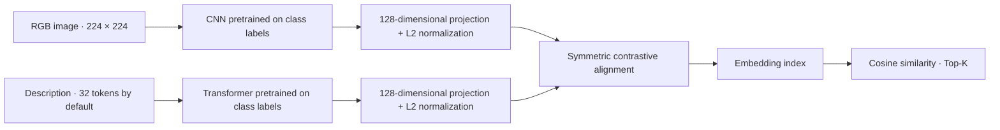

# CLIP · Multimodal Image–Text Retrieval


**Find images using a description, and descriptions using an image.**

[Quickstart](#quickstart) · [Architecture](#architecture) · [Data](#data) · [Docker](#docker-cpu) · [Results](#results-and-limitations) · [Report](reports/Rapport.pdf)

Second-year Master's project at the University of Montpellier, by **Belguith Ahmed Rami and Benboubaker Majdi** (January 2026).

The system retrieves images from a text description, or descriptions from an image. It uses a CNN and a custom Transformer, pretrained on four classes (`ball`, `bike`, `dog`, `water`), then aligned in a shared 128-dimensional space using a symmetric contrastive loss. This is an educational model inspired by CLIP, trained locally without pretrained OpenAI weights.

This version separates the academic experiments from an executable Python pipeline. It provides a foundation for production development: reusable modules, a CLI, run configuration, model exports, an index tied to the model, and quantitative evaluation. It does not yet include a deployed web service.

## Quickstart

From a Linux/WSL Bash terminal, with Python 3.11 or 3.12:

```bash
git clone https://github.com/ahmedramibelghuith/CLIP_Dog_Ball_Cyclist.git
cd CLIP_Dog_Ball_Cyclist
python3 -m venv .venv
source .venv/bin/activate
python -m pip install --upgrade pip
python -m pip install -r requirements.txt
python main.py --help

# Verify the complete pipeline without downloading Flickr
python tests/smoke_pipeline.py
```

The test uses 20 temporary synthetic images and one epoch per model. It checks that the pipeline works, without measuring retrieval quality on real images. **Trained weights are not included**: to search Flickr images, prepare the [data](#data), then [train the models](#train-all-three-models) and [build the index](#build-an-index-and-search).

| Command | Purpose | Output |
|---|---|---|
| `python main.py train` | Pretrain the classifiers, then align the encoders | `.keras` models, configuration, splits, and histories |
| `python main.py index` | Encode the gallery using the run's model | `index.npz` |
| `python main.py search` | Rank matches for a text or image query | JSON results |
| `python main.py evaluate` | Measure retrieval on the test split | `metrics.json` |

Each command lists its options with `--help`. For containerized execution, see [Docker (CPU)](#docker-cpu).

## Contents

- [Architecture](#architecture)
- [Project structure](#project-structure)
- [Installation](#installation)
- [Data](#data)
- [Train all three models](#train-all-three-models)
- [Build an index and search](#build-an-index-and-search)
- [Evaluate](#evaluate)
- [Tests](#tests)
- [Docker (CPU)](#docker-cpu)
- [Original notebooks and report](#original-notebooks-and-report)
- [Results and limitations](#results-and-limitations)
- [Troubleshooting](#troubleshooting)
- [Roadmap to production](#roadmap-to-production)
- [Contributing and reporting issues](#contributing-and-reporting-issues)

## Architecture



Both encoders are jointly fine-tuned during the CLIP stage. At inference time, the query is encoded and its vector is compared against embeddings from the other modality. The four classes are used for pretraining; retrieval results are image/description pairs ranked by similarity.

## Project structure

```text
.
├── Dockerfile                   # CPU image for the pipeline
├── .dockerignore                # Minimal build context
├── main.py                      # CLI entry point
├── src/clip_project/
│   ├── cli.py                   # Arguments and commands
│   ├── data.py                  # CSV validation and shared data splits
│   ├── models.py                # CNN, Transformer, and CLIP loss
│   ├── pipeline.py              # Preprocessing, training, and loading
│   └── retrieval.py             # Indexing, search, and Recall@K
├── notebooks/                   # Original experiments and recorded outputs
│   ├── 13_Image_Classifier.ipynb
│   ├── 13_TextClassifier.ipynb
│   ├── 13_CLIP_Infernce.ipynb
│   └── UTILS.py
├── reports/                     # Report and notebook PDF exports
├── models_forclip/              # Preserved historical CSVs, figures, and indexes
├── tests/                       # Data splits, preprocessing, and serialization
├── requirements.txt             # Pipeline dependencies
├── requirements-notebooks.txt   # Additional notebook dependencies
└── artifacts/                   # Generated runs, excluded from Git
```

## Installation

Target environment: **Python 3.11 or 3.12**, TensorFlow 2.20, Keras 3.13, and NumPy 2.1.3. Installation commands are provided in the [quickstart](#quickstart). The main pipeline only requires `requirements.txt`; Jupyter and visualization dependencies are listed separately in `requirements-notebooks.txt`.

On Windows PowerShell, activate the environment with `.venv\Scripts\Activate.ps1`. The pipeline can run on a CPU; a GPU speeds up training. For Linux/WSL with an NVIDIA GPU, follow the [official TensorFlow installation guide](https://www.tensorflow.org/install/pip) for the appropriate CUDA dependencies.

Direct dependencies are pinned; a complete lockfile for transitive dependencies is still needed before deployment.

## Data

The original dataset contains **800 image/description pairs**, with 200 pairs per class. Download and extract the [archive used in the notebooks](https://www.lirmm.fr/~poncelet/Ressources/flickr_long_subset.zip) to obtain a layout such as:

```text
data/flickr_long_subset/
├── captions.csv
└── images/
    ├── ball/
    ├── bike/
    ├── dog/
    └── water/
```

The CLI does not download the dataset automatically. The CSV must contain `image_path,label,caption`, with exactly one pair per image, a nonempty description, and at least ten images per class. Relative paths are resolved from `--image-root`, for example `images/dog/dog_581.jpg`.

Images and `.keras` weights are not included in this repository. The historical `.npz` indexes alone cannot encode a new query. Check archive availability and data redistribution rights before distributing an application.

## Train all three models

```bash
python main.py train \
  --csv data/flickr_long_subset/captions.csv \
  --image-root data/flickr_long_subset \
  --output artifacts/run-001 \
  --classifier-epochs 8 \
  --clip-epochs 10 \
  --batch-size 32 \
  --sequence-length 32 \
  --seed 42
```

The command creates shared, stratified **80% / 10% / 10%** splits, adapts the tokenizer on the training split only, pretrains both classifiers, and then fine-tunes the encoders using the CLIP loss. Training and retrieval share the same image preprocessing: RGB, pixels in `[0,1]`, and resizing to `224×224`. All validation examples are retained.

The output directory must be empty to preserve previous runs. It contains:

- `train.csv`, `val.csv`, `test.csv`: the splits used, with absolute image paths;
- `config.json`: classes, vocabulary, preprocessing, hyperparameters, and runtime versions;
- `image.keras`, `text.keras`, `clip.keras`: models with their best validation weights restored;
- `*_history.json`: numerical training curves.

The tokenizer is never readapted after text pretraining. Its vocabulary, standardization, and sequence length are restored from `config.json`. Custom layers are registered for [Keras serialization](https://keras.io/guides/serialization_and_saving/).

Absolute paths in the CSVs and indexes are local to the machine. After moving the data, update the CSVs and rebuild the index.

## Build an index and search

```bash
python main.py index \
  --run artifacts/run-001 \
  --csv data/flickr_long_subset/captions.csv \
  --image-root data/flickr_long_subset

python main.py search --run artifacts/run-001 --text "a dog on the beach" --top-k 5

python main.py search --run artifacts/run-001 --image path/to/image.jpg --top-k 5
```

`index` creates or replaces `index.npz` in the run directory. It contains embeddings for both modalities, paths, descriptions, and a SHA-256 fingerprint of the model and its configuration. `search` rejects an index whose fingerprint no longer matches the run. Rebuild the index whenever the gallery data changes as well.

Results are printed as JSON with a cosine similarity score, image path, and description. Vectors are L2-normalized; scores are not probabilities. Exact retrieval using matrix multiplication is suitable for this small gallery.

## Evaluate

```bash
python main.py evaluate --run artifacts/run-001
```

This command encodes only the pairs in the run's `test.csv`, checks that their paths do not overlap with training or validation paths, and computes **Recall@1, Recall@5, and Recall@10** in both directions. Results are saved to `metrics.json`, together with the gallery size. Cutoffs larger than the gallery size are omitted.

Evaluation assumes one positive description per image. A full gallery can be used for demonstrations, but training examples must not be used to measure generalization. The seed controls the main sources of randomness; it does not guarantee identical results across all hardware.

## Tests

```bash
PYTHONPATH=src python -m unittest discover -s tests -v
```

On PowerShell, set `$env:PYTHONPATH="src"` before running the Python command. Data tests run without TensorFlow; model tests are skipped if it is not installed. Tests cover pixel normalization, preservation of embeddings after saving and reloading, tokenizer consistency, and Recall@K computation.

To also exercise all five CLI invocations end to end on 20 temporary synthetic images:

```bash
python tests/smoke_pipeline.py
```

This test trains each model for one epoch, reloads the artifacts, and checks that a stale index is rejected. It does not measure retrieval quality on Flickr.

## Docker (CPU)

The `Dockerfile` packages the CLI pipeline and its tests in a Python 3.12 image, using the same dependencies as the local installation. Commands run as a non-root user. Dataset images, model artifacts, and reports stay outside the container image; data and runs are mounted from the host. The build context is restricted through [`.dockerignore`](.dockerignore), as described in the [Docker documentation](https://docs.docker.com/build/concepts/context/#dockerignore-files).

### Build and check the image

Install Docker Engine or Docker Desktop and start its engine. From the project root on Linux or WSL:

```bash
docker build -t clip-project:cpu .
docker run --rm clip-project:cpu --help

docker run --rm --entrypoint python clip-project:cpu \
  -m unittest discover -s /app/tests -v

# Optional end-to-end test using temporary synthetic images
docker run --rm --entrypoint python clip-project:cpu /app/tests/smoke_pipeline.py
```

The first build downloads TensorFlow and may take several minutes. This image does not use a GPU; adding `--gpus all` alone does not turn it into a CUDA image.

### Mount data and persist results

Extract the dataset into `data/flickr_long_subset/`, as described above, then define this function in a **Linux/WSL Bash terminal**, from the project root:

```bash
mkdir -p data artifacts

clip() {
  docker run --rm \
    --user "$(id -u):$(id -g)" \
    --mount "type=bind,src=$PWD/data,dst=/data,readonly" \
    --mount "type=bind,src=$PWD/artifacts,dst=/artifacts" \
    clip-project:cpu "$@"
}
```

Data is mounted read-only, and results are written to `artifacts/`. The `--user` option preserves Linux ownership of generated files. Redefine the function in each new terminal.

### Train, index, search, and evaluate

```bash
clip train \
  --csv /data/flickr_long_subset/captions.csv \
  --image-root /data/flickr_long_subset \
  --output /artifacts/run-docker-001 \
  --classifier-epochs 8 --clip-epochs 10 --batch-size 32 --seed 42

clip index \
  --run /artifacts/run-docker-001 \
  --csv /data/flickr_long_subset/captions.csv \
  --image-root /data/flickr_long_subset

clip search --run /artifacts/run-docker-001 --text "a dog on the beach" --top-k 5

# Replace this path with an image available under data/
clip search --run /artifacts/run-docker-001 --image /data/my-query.jpg --top-k 5

clip evaluate --run /artifacts/run-docker-001
```

The run persists on the host in `artifacts/run-docker-001/`, even after the container is removed. Use a different name for a new training run: the output directory must be empty.

CSVs and indexes store **container paths** (`/data/...`). Keep the same mount destinations for every command. To reuse a run trained outside Docker, update the paths in the split CSVs and rebuild the index; absolute host paths are not translated automatically.

## Original notebooks and report

The notebooks retain their original content and recorded outputs. To open them:

```bash
python -m pip install -r requirements-notebooks.txt
cd notebooks
jupyter lab
```

`UTILS.py` is placed alongside the notebooks to resolve their original imports. Their `./models_forclip` and `./flickr_subset2` paths remain relative to the execution directory: adjust them before rerunning these experiments. The CLI does not execute the notebooks or reload their historical indexes.

The [academic report](reports/Rapport.pdf) and the three PDF exports are preserved in `reports/`.

Open the experiments directly: [image classifier](notebooks/13_Image_Classifier.ipynb), [text classifier](notebooks/13_TextClassifier.ipynb), and [CLIP and inference](notebooks/13_CLIP_Infernce.ipynb).

## Results and limitations

The recorded outputs of the original notebooks contain the following measurements:

| Model | Metric | Recorded value |
|---|---|---:|
| Image classifier | Best validation accuracy | 31.25% |
| Text classifier | Best validation accuracy | 75.63% |
| CLIP | Best validation loss | 3.4747 |

**These numbers are not results from the restructured pipeline.** The historical splits and tokenizer differ. The new pipeline must be retrained and evaluated using Recall@K before drawing conclusions about its quality.

- The dataset is limited to 800 pairs and four categories.
- The original CLIP training shows overfitting; decreasing training loss alone does not demonstrate retrieval quality.
- The current version is a CLI; it does not provide an API or web interface.
- A CPU Docker image definition is included; its build still needs to be validated with a running Docker engine.

## Troubleshooting

| Problem | Action |
|---|---|
| `No module named tensorflow` | Activate the correct environment and install `requirements.txt`. |
| Missing `clip.keras` or `config.json` | Run `train`, then check the directory passed to `--run`. |
| Image not found | Check `image_path`, `--image-root`, and Docker mount destinations. |
| Output directory is not empty | Choose a new run directory for `--output`. |
| Index does not match the model | Rerun `index` with the run's model and configuration. |
| Cannot connect to the Docker engine | Start Docker Desktop or Docker Engine, then check `docker version`. |
| Out of memory during training | Reduce `--batch-size`, keeping at least two pairs per batch. |

## Roadmap to production

1. Validate metrics and an acceptance threshold on representative data; compare against a pretrained multimodal model.
2. Lock the environment, automate tests in CI, and version datasets and artifacts.
3. Expose retrieval through an API with size limits, file validation, and integration tests.
4. Extend the CLI Docker image to support the future API service, loading encoders once at startup.
5. Monitor latency, memory, and retrieval quality; use a specialized vector index if the gallery grows.

The CNN deliberately retains the academic architecture with `Flatten`, which is costly for 800 images. A move to global pooling or a pretrained backbone should be evaluated separately. Descriptions are truncated to 32 tokens by default; use `--sequence-length` to experiment with another length.

## Contributing and reporting issues

For a fix, open a pull request describing the change and the validation commands you ran. To report a problem, use the [repository issues](https://github.com/ahmedramibelghuith/CLIP_Dog_Ball_Cyclist/issues), including the command, Python/TensorFlow versions, operating system, and error message.

**Authors:** Belguith Ahmed Rami and Benboubaker Majdi — second-year Master's program, University of Montpellier. The [report](reports/Rapport.pdf) describes the original academic work.
