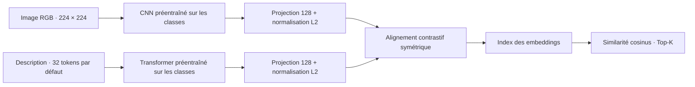

# CLIP · Recherche multimodale image–texte


**Retrouver des images par une description et des descriptions par une image.**

[Prise en main](#démarrage-rapide) · [Architecture](#architecture) · [Données](#données) · [Docker](#docker-cpu) · [Résultats](#résultats-et-limites) · [Rapport](reports/Rapport.pdf)

Projet de Master 2, Université de Montpellier, réalisé par **Belguith Ahmed Rami et Benboubaker Majdi** (janvier 2026).

Le système recherche des images à partir d'une description, ou des descriptions à partir d'une image. Il utilise un CNN et un Transformer personnalisé, préentraînés sur quatre classes (`ball`, `bike`, `dog`, `water`), puis alignés dans un espace commun de dimension 128 par une perte contrastive symétrique. Il s'agit d'un modèle pédagogique inspiré de CLIP, entraîné localement, sans poids OpenAI préentraînés.

Cette version sépare les expériences académiques d'un pipeline Python exécutable. Elle apporte une base d'industrialisation : modules réutilisables, CLI, configuration des runs, export des modèles, index associé au modèle et évaluation quantitative. Elle ne fournit pas encore de service web déployé.

## Démarrage rapide

Depuis un terminal Bash Linux/WSL, avec Python 3.11 ou 3.12 :

```bash
git clone https://github.com/ahmedramibelghuith/CLIP_Dog_Ball_Cyclist.git
cd CLIP_Dog_Ball_Cyclist
python3 -m venv .venv
source .venv/bin/activate
python -m pip install --upgrade pip
python -m pip install -r requirements.txt
python main.py --help

# Vérifier la chaîne complète sans télécharger Flickr
python tests/smoke_pipeline.py
```

Le test utilise 20 images synthétiques temporaires et une époque par modèle. Il vérifie le fonctionnement du pipeline, sans mesurer sa pertinence sur des images réelles. **Les poids entraînés ne sont pas fournis** : pour une recherche sur Flickr, préparer les [données](#données), puis [entraîner les modèles](#entraîner-les-trois-modèles) et [construire l'index](#construire-un-index-et-rechercher).

| Commande | Rôle | Résultat |
|---|---|---|
| `python main.py train` | Préentraîner les classifieurs puis aligner les encodeurs | Modèles `.keras`, configuration, partitions et historiques |
| `python main.py index` | Encoder la galerie avec le modèle du run | `index.npz` |
| `python main.py search` | Classer les correspondances d'une requête texte ou image | Résultats JSON |
| `python main.py evaluate` | Mesurer la recherche sur le test | `metrics.json` |

Chaque commande expose ses options avec `--help`. L'alternative conteneurisée est décrite dans [Docker (CPU)](#docker-cpu).

## Sommaire

- [Architecture](#architecture)
- [Organisation](#organisation)
- [Installation](#installation)
- [Données](#données)
- [Entraîner les trois modèles](#entraîner-les-trois-modèles)
- [Construire un index et rechercher](#construire-un-index-et-rechercher)
- [Évaluer](#évaluer)
- [Tests](#tests)
- [Docker (CPU)](#docker-cpu)
- [Notebooks et rapport historiques](#notebooks-et-rapport-historiques)
- [Résultats et limites](#résultats-et-limites)
- [Dépannage](#dépannage)
- [Suite vers la production](#suite-vers-la-production)
- [Contribuer et signaler un problème](#contribuer-et-signaler-un-problème)

## Architecture



Les deux encodeurs sont ajustés conjointement pendant l'étape CLIP. L'inférence encode la requête puis compare son vecteur aux embeddings de l'autre modalité. Les quatre classes servent au préentraînement ; les résultats de recherche sont des paires image/description classées par similarité.

## Organisation

```text
.
├── Dockerfile                   # Image CPU du pipeline
├── .dockerignore                # Contexte de construction minimal
├── main.py                      # Point d'entrée CLI
├── src/clip_project/
│   ├── cli.py                   # Arguments et commandes
│   ├── data.py                  # Validation CSV et partition commune
│   ├── models.py                # CNN, Transformer et perte CLIP
│   ├── pipeline.py              # Prétraitement, entraînement et chargement
│   └── retrieval.py             # Indexation, recherche et Recall@K
├── notebooks/                   # Expériences originales et sorties historiques
│   ├── 13_Image_Classifier.ipynb
│   ├── 13_TextClassifier.ipynb
│   ├── 13_CLIP_Infernce.ipynb
│   └── UTILS.py
├── reports/                     # Rapport et exports PDF des notebooks
├── models_forclip/              # CSV, figures et index historiques conservés
├── tests/                       # Partition, prétraitement et sérialisation
├── requirements.txt             # Dépendances du pipeline
├── requirements-notebooks.txt   # Dépendances supplémentaires des notebooks
└── artifacts/                   # Runs générés, exclus de Git
```

## Installation

Base cible : **Python 3.11 ou 3.12**, TensorFlow 2.20, Keras 3.13 et NumPy 2.1.3. Les commandes d'installation sont regroupées dans le [démarrage rapide](#démarrage-rapide). Le pipeline principal nécessite uniquement `requirements.txt` ; les dépendances Jupyter et de visualisation sont séparées dans `requirements-notebooks.txt`.

Sous Windows PowerShell, activer l'environnement avec `.venv\Scripts\Activate.ps1`. Le CPU suffit pour lancer le pipeline ; un GPU accélère l'entraînement. Pour Linux/WSL avec GPU NVIDIA, consulter la [procédure officielle TensorFlow](https://www.tensorflow.org/install/pip) pour les dépendances CUDA adaptées.

Les dépendances directes sont fixées ; un verrou complet des dépendances transitives reste à établir avant déploiement.

## Données

Le jeu historique comprend **800 paires image/description**, soit 200 par classe. Télécharger et extraire l'[archive utilisée dans les notebooks](https://www.lirmm.fr/~poncelet/Ressources/flickr_long_subset.zip) pour obtenir, par exemple :

```text
data/flickr_long_subset/
├── captions.csv
└── images/
    ├── ball/
    ├── bike/
    ├── dog/
    └── water/
```

Le téléchargement n'est pas automatique dans la CLI. Le CSV doit contenir `image_path,label,caption`, avec une seule paire par image, une description non vide et au moins dix images par classe. Les chemins relatifs sont résolus depuis `--image-root` : par exemple `images/dog/dog_581.jpg`.

Les images et les poids `.keras` ne sont pas fournis dans ce dépôt. Les anciens index `.npz` ne suffisent pas pour encoder une nouvelle requête. L'accès actuel à l'archive et les droits de redistribution des données doivent être vérifiés avant diffusion d'une application.

## Entraîner les trois modèles

```bash
python main.py train \
  --csv data/flickr_long_subset/captions.csv \
  --image-root data/flickr_long_subset \
  --output artifacts/run-001 \
  --classifier-epochs 8 \
  --clip-epochs 10 \
  --batch-size 32 \
  --sequence-length 32 \
  --seed 42
```

La commande effectue une partition stratifiée commune **80 % / 10 % / 10 %**, adapte le tokenizer uniquement sur le train, préentraîne les deux classifieurs, puis ajuste les encodeurs avec la perte CLIP. Le prétraitement image est partagé entre entraînement et recherche : RGB, pixels en `[0,1]`, redimensionnement en `224×224`. La validation conserve tous ses exemples.

Le dossier de sortie doit être vide, afin de préserver les runs précédents. Il contient :

- `train.csv`, `val.csv`, `test.csv` : partitions utilisées, avec chemins absolus ;
- `config.json` : classes, vocabulaire, prétraitement, hyperparamètres et versions du runtime ;
- `image.keras`, `text.keras`, `clip.keras` : modèles avec les meilleurs poids de validation restaurés ;
- `*_history.json` : courbes d'apprentissage sous forme de valeurs numériques.

Le tokenizer n'est jamais réadapté après le préentraînement texte. Son vocabulaire, sa standardisation et sa longueur de séquence sont restaurés depuis `config.json`. Les couches personnalisées sont enregistrées pour la [sérialisation Keras](https://keras.io/guides/serialization_and_saving/).

Les chemins absolus des CSV et des index sont locaux à la machine. Après déplacement des données, adapter les CSV et reconstruire l'index.

## Construire un index et rechercher

```bash
python main.py index \
  --run artifacts/run-001 \
  --csv data/flickr_long_subset/captions.csv \
  --image-root data/flickr_long_subset

python main.py search --run artifacts/run-001 --text "a dog on the beach" --top-k 5

python main.py search --run artifacts/run-001 --image chemin/vers/image.jpg --top-k 5
```

`index` construit ou remplace `index.npz` dans le run. Il contient les embeddings des deux modalités, les chemins, les descriptions et une empreinte SHA-256 du modèle et de sa configuration. `search` refuse un index dont l'empreinte ne correspond plus au run. Si les données de la galerie changent, reconstruire également l'index.

Les résultats sont affichés en JSON avec score cosinus, chemin et description. Les vecteurs sont normalisés L2 ; les scores ne sont pas des probabilités. La recherche exacte par produit matriciel convient à cette petite galerie.

## Évaluer

```bash
python main.py evaluate --run artifacts/run-001
```

Cette commande encode uniquement les paires du `test.csv` du run, vérifie l'absence de chevauchement de chemins avec train/validation et calcule **Recall@1, Recall@5 et Recall@10** dans les deux sens. Les résultats sont sauvegardés dans `metrics.json` avec la taille de la galerie. Les seuils supérieurs à la taille de la galerie sont omis.

L'évaluation suppose une seule description positive par image. Une galerie globale peut servir à la démonstration, mais les exemples d'entraînement ne doivent pas servir à mesurer la généralisation. La seed fixe les principales sources aléatoires ; elle ne garantit pas des résultats identiques entre tous les matériels.

## Tests

```bash
PYTHONPATH=src python -m unittest discover -s tests -v
```

Sous PowerShell : définir `$env:PYTHONPATH="src"` avant la commande Python. Les tests de données fonctionnent sans TensorFlow ; les tests de modèle sont ignorés s'il n'est pas installé. Ils vérifient notamment la normalisation des pixels, la conservation des embeddings après sauvegarde/rechargement, le tokenizer et le calcul du Recall@K.

Pour vérifier aussi les cinq commandes de bout en bout sur 20 images synthétiques temporaires :

```bash
python tests/smoke_pipeline.py
```

Ce test entraîne chaque modèle pendant une époque, recharge les artefacts et vérifie le rejet d’un index périmé. Il ne mesure pas la qualité sur Flickr.

## Docker (CPU)

Le `Dockerfile` fournit le pipeline CLI et ses tests dans une image Python 3.12, avec les mêmes dépendances que l'installation locale. Il exécute les commandes avec un utilisateur non root. Les images, modèles et rapports restent hors de l'image ; les données et les runs sont montés depuis la machine hôte. Le contexte est limité par [`.dockerignore`](.dockerignore), selon le mécanisme décrit dans la [documentation Docker](https://docs.docker.com/build/concepts/context/#dockerignore-files).

### Construire et vérifier l'image

Installer Docker Engine ou Docker Desktop et démarrer son moteur. Depuis la racine du projet, sous Linux ou WSL :

```bash
docker build -t clip-project:cpu .
docker run --rm clip-project:cpu --help

docker run --rm --entrypoint python clip-project:cpu \
  -m unittest discover -s /app/tests -v

# Test complet facultatif sur des images synthétiques temporaires
docker run --rm --entrypoint python clip-project:cpu /app/tests/smoke_pipeline.py
```

La première construction télécharge TensorFlow et peut prendre plusieurs minutes. Aucun GPU n'est utilisé par cette image ; ajouter `--gpus all` ne suffit pas à la convertir en image CUDA.

### Monter les données et conserver les résultats

Extraire le dataset dans `data/flickr_long_subset/`, comme décrit plus haut, puis définir cette fonction dans le terminal **Bash Linux/WSL**, depuis la racine du projet :

```bash
mkdir -p data artifacts

clip() {
  docker run --rm \
    --user "$(id -u):$(id -g)" \
    --mount "type=bind,src=$PWD/data,dst=/data,readonly" \
    --mount "type=bind,src=$PWD/artifacts,dst=/artifacts" \
    clip-project:cpu "$@"
}
```

Les données sont montées en lecture seule et les résultats sont écrits dans `artifacts/`. L'option `--user` conserve le propriétaire Linux des fichiers générés. La fonction doit être redéfinie dans chaque nouveau terminal.

### Entraîner, indexer, rechercher et évaluer

```bash
clip train \
  --csv /data/flickr_long_subset/captions.csv \
  --image-root /data/flickr_long_subset \
  --output /artifacts/run-docker-001 \
  --classifier-epochs 8 --clip-epochs 10 --batch-size 32 --seed 42

clip index \
  --run /artifacts/run-docker-001 \
  --csv /data/flickr_long_subset/captions.csv \
  --image-root /data/flickr_long_subset

clip search --run /artifacts/run-docker-001 --text "a dog on the beach" --top-k 5

# Remplacer le chemin par celui d'une image présente dans data/
clip search --run /artifacts/run-docker-001 --image /data/ma-requete.jpg --top-k 5

clip evaluate --run /artifacts/run-docker-001
```

Le run persiste sur l'hôte dans `artifacts/run-docker-001/`, même après suppression du conteneur. Utiliser un autre nom pour un nouvel entraînement : le dossier de sortie doit être vide.

Les CSV et index enregistrent les chemins **du conteneur** (`/data/...`). Garder les mêmes destinations de montage pour toutes les commandes. Pour réutiliser un run entraîné hors Docker, adapter les chemins des CSV de partition et reconstruire l'index ; les chemins absolus de la machine hôte ne sont pas automatiquement traduits.

## Notebooks et rapport historiques

Les notebooks conservent leur contenu et leurs sorties d'origine. Pour les consulter :

```bash
python -m pip install -r requirements-notebooks.txt
cd notebooks
jupyter lab
```

Le module `UTILS.py` est placé à côté des notebooks pour résoudre leurs imports historiques. Leurs chemins `./models_forclip` et `./flickr_subset2` restent relatifs au dossier d'exécution : les adapter avant de relancer ces expériences. La CLI n'exécute pas les notebooks et ne recharge pas leurs anciens index.

Le [rapport académique](reports/Rapport.pdf) et les trois exports PDF sont conservés dans `reports/`.

Accès direct aux expériences : [classifieur image](notebooks/13_Image_Classifier.ipynb), [classifieur texte](notebooks/13_TextClassifier.ipynb), [CLIP et inférence](notebooks/13_CLIP_Infernce.ipynb).

## Résultats et limites

Les sorties enregistrées des notebooks historiques contiennent les mesures suivantes :

| Modèle | Mesure | Valeur enregistrée |
|---|---|---:|
| Classifieur image | Meilleure accuracy de validation | 31,25 % |
| Classifieur texte | Meilleure accuracy de validation | 75,63 % |
| CLIP | Meilleure perte de validation | 3,4747 |

**Ces chiffres ne sont pas les résultats du pipeline restructuré.** Les partitions et le tokenizer historiques diffèrent. Le nouveau pipeline doit être réentraîné et évalué avec les Recall@K avant toute conclusion sur sa qualité.

- Le dataset reste limité à 800 paires et quatre catégories.
- L'ancien entraînement CLIP montre un surapprentissage ; une perte décroissante sur le train ne suffit pas à démontrer la qualité de recherche.
- La version actuelle est une CLI ; elle ne fournit pas d'API ni d'interface web.
- L'image Docker CPU est fournie ; sa construction reste à valider sur un moteur Docker actif.

## Dépannage

| Problème | Action |
|---|---|
| `No module named tensorflow` | Activer le bon environnement et installer `requirements.txt`. |
| `clip.keras` ou `config.json` absent | Lancer `train`, puis vérifier le dossier indiqué par `--run`. |
| Image introuvable | Vérifier `image_path`, `--image-root` et les points de montage Docker. |
| Dossier de sortie non vide | Choisir un nouveau dossier de run pour `--output`. |
| Index incompatible avec le modèle | Relancer `index` avec le modèle et la configuration du run. |
| Impossible de joindre le moteur Docker | Démarrer Docker Desktop ou Docker Engine, puis vérifier `docker version`. |
| Mémoire insuffisante pendant l'entraînement | Réduire `--batch-size` en gardant au moins deux paires par batch. |

## Suite vers la production

1. Valider les métriques et un seuil d'acceptation sur des données représentatives ; comparer à un modèle multimodal préentraîné.
2. Verrouiller l'environnement, automatiser les tests en CI et versionner les données et les artefacts.
3. Exposer la recherche via une API avec limites de taille, validation des fichiers et tests d'intégration.
4. Étendre l’image Docker de la CLI au futur service API et charger les encodeurs une seule fois au démarrage.
5. Mesurer latence, mémoire et qualité des résultats ; utiliser un index vectoriel spécialisé si la galerie grandit.

Le CNN conserve volontairement l'architecture académique avec `Flatten`, coûteuse pour 800 images. Une évolution vers un pooling global ou un backbone préentraîné devra être évaluée séparément. Les descriptions sont tronquées à 32 tokens par défaut ; `--sequence-length` permet de tester une autre longueur.

## Contribuer et signaler un problème

Pour une correction, ouvrir une pull request avec une description du changement et les commandes de validation exécutées. Pour signaler un problème, utiliser les [issues du dépôt](https://github.com/ahmedramibelghuith/CLIP_Dog_Ball_Cyclist/issues) en précisant la commande, les versions de Python/TensorFlow, le système et le message d'erreur.

**Auteurs :** Belguith Ahmed Rami et Benboubaker Majdi — Master 2, Université de Montpellier. Le [rapport](reports/Rapport.pdf) décrit le travail académique initial.
